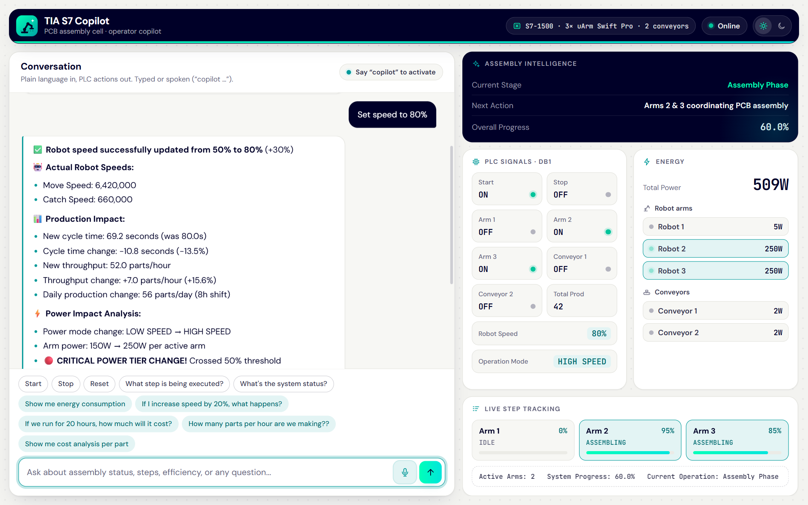
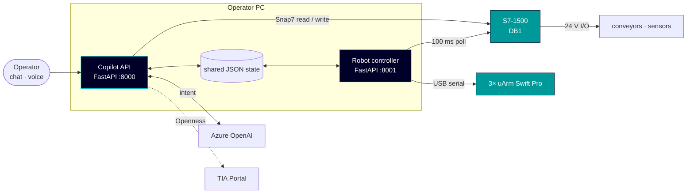
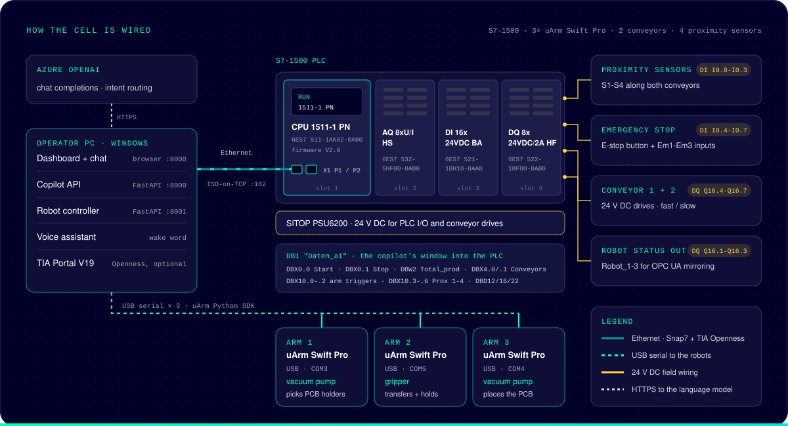
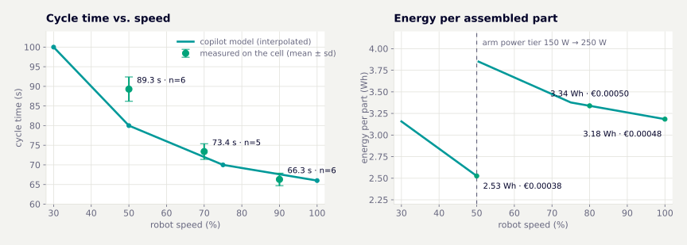

<p align="center">
  <picture>
    <source media="(prefers-color-scheme: dark)" srcset="docs/assets/hero-dark.svg">
    
  </picture>
</p>

<p align="center">
  
  
  
  
  
  
  
  
</p>

<p align="center">
  <a href="#why"><b>Why</b></a> ·
  <a href="#what-it-does"><b>What it does</b></a> ·
  <a href="#one-cycle-on-the-cell"><b>The cell</b></a> ·
  <a href="#how-it-works"><b>How it works</b></a> ·
  <a href="#results"><b>Results</b></a> ·
  <a href="#quick-start"><b>Quick start</b></a> ·
  <a href="#documentation"><b>Docs</b></a>
</p>

**TIA S7 Copilot** is an operator assistant for a PCB assembly cell with an S7-1500 PLC, two
conveyors and three uArm Swift Pro robot arms. Operators type or say what they need, for example
*"set speed to 80%"* or *"if we run for 20 hours, how much will it cost?"*. The copilot either
turns the request into checked PLC writes and robot commands or answers it from live cell data.
Nobody has to open TIA Portal or know a single DB address.

<picture>
  <source media="(prefers-color-scheme: dark)" srcset="docs/assets/dashboard-dark.png">
  
</picture>
<p align="center"><sub>Actual dashboard with illustrative API responses for <i>"Set speed to 80%"</i>, captured without hardware. Chat on the left; DB1 signals, component power and arm steps on the right. Light and dark themes follow your GitHub appearance.</sub></p>

## Why

| Task | Without the copilot | With TIA S7 Copilot |
|---|---|---|
| **Change the line speed** | Go online in TIA Portal, find both conveyor timer presets in DB1, calculate and write the new values, then change the robot speed separately | *"Set speed to 80%"*: both timers are written and read back, the arms use the new speed from their next move, and the reply shows the effect on cycle time, power and cost |
| **Ask "what if?"** | Estimate by hand | Requests classified as scenarios, such as *"What will my cycle time be at 90%?"*, return model estimates without applying a speed change |
| **See what the cell is doing** | Watch tables in the engineering tool | Live PLC signals, sensors, each arm's current step and the assembly stage in one browser tab |
| **Stop it** | Hard-wired E-stop | The E-stop is still there. In addition, typing or saying *"stop"* writes the PLC stop bit directly without waiting for the language model |

## What it does

<table>
<tr>
<td width="50%" valign="top">
<b>Natural-language control</b><br>
Start, stop, reset and speed changes from chat or voice. The language model only classifies the
request. Python checks, clamps and executes it.
</td>
<td width="50%" valign="top">
<b>Command handling</b><br>
Emergency words skip the language model. Speed values are clamped, and the model is instructed
to route questions to analysis. Classification is not a safety boundary.
</td>
</tr>
<tr>
<td valign="top">
<b>Live cell telemetry</b><br>
DB1 signals, proximity sensors, each arm's current step and progress, and the assembly stage.
The dashboard refreshes every 1.5–2 s.
</td>
<td valign="top">
<b>Energy and cost analytics</b><br>
Power per component, cost per part and every on/off scenario. The model starts from estimates
and switches to measured cycles as they come in.
</td>
</tr>
<tr>
<td valign="top">
<b>Position-triggered coordination</b><br>
Arms hand over when another arm <i>reaches a coordinate</i>, not after a fixed delay. The
coordination was exercised at 50%, 70% and 90% speed on the original cell.
</td>
<td valign="top">
<b>TIA Portal Openness, dual mode</b><br>
Reads tags, blocks and hardware from the engineering project. It attaches to an open TIA Portal,
opens one in the background, or falls back to the last export.
</td>
</tr>
<tr>
<td valign="top">
<b>Voice</b><br>
Say <i>"copilot, …"</i> to give a command hands-free. Spoken commands go through the same
pipeline as typed ones and appear in the same chat.
</td>
<td valign="top">
<b>Smaller prompts</b><br>
Context modules are added by keyword. On the cell this cut prompts from about 6,500 to about
1,800 tokens (−72%).
</td>
</tr>
</table>

## One cycle on the cell

<p align="center">
  
</p>

This accelerated schematic uses the controller's step names, DB1 bits and hand-over events;
it is not a recording or a calibrated motion simulation. Arm 1
loads a PCB holder onto conveyor 1. Arm 2 grips it at point B, and as soon as Arm 2 reaches its
trigger coordinate, Arm 3 brings the PCB. After assembly the part travels on conveyor 2, and
sensor 4 increments `Total_prod`.

## How it works



The operator-facing **copilot API** and the real-time **robot controller** run as separate
processes, separating LLM classification from the PLC polling loop. The loop sleeps for 100 ms
between iterations; I/O and processing add latency. This is not a hard real-time controller.
The processes exchange status through files and HTTP.

**What happens after *"set speed to 80%"*:**

1. **Fast path.** `start`, `stop`, `reset`, `e-stop`, `emergency`, `halt` and `abort` are handled before any LLM call.
2. **Classify.** The LLM replies in a fixed format: `ACTION_TYPE: SPEED_CHANGE`, `TARGET_SPEED: 80`.
  Requests classified as `SCENARIO_ANALYSIS` are answered without applying a speed change.
3. **Check and translate.** The value is clamped to 1–100%. The conveyor timers become
   `DB1.DBD12` 5500 → 4000 ms and `DB1.DBD16` 7000 → 5800 ms.
4. **Write and verify.** Snap7 writes both DInts and reads them back. `robot_speed.json` is updated
   for the robot controller.
5. **Explain.** Cycle time 80.0 → 69.2 s, +7 parts/h, arm power tier 150 → 250 W, new cost per hour and per part.

More detail: [architecture](docs/architecture.md), including the state machine, the shared files and the energy model.

## Hardware

<p align="center">
  
</p>

| Area | Components |
|---|---|
| **PLC** | S7-1500 CPU 1511-1 PN (6ES7 511-1AK02-0AB0), DI 16x24VDC BA, DQ 8x24VDC/2A HF, AQ 8xU/I HS, SITOP PSU6200 |
| **Robots** | 3× uArm Swift Pro on USB: Arm 1 vacuum pump (`COM3`), Arm 2 gripper (`COM5`), Arm 3 vacuum pump (`COM4`) |
| **Field** | 2 conveyor modules, 4 proximity sensors, emergency-stop inputs |
| **PLC interface** | DB1 `Daten_ai`: start and stop bits, production counter, arm request bits, sensor mirror, two DInt timer presets |

The complete bill of materials, DB1 map, I/O list and required CPU settings are in
[docs/hardware.md](docs/hardware.md).

## Results

<picture>
  <source media="(prefers-color-scheme: dark)" srcset="docs/assets/results-dark.svg">
  
</picture>
<p align="center"><sub>Left: the copilot's cycle-time model compared with the cycles measured on the cell. Right: modelled energy per part. Above 50% the arms move to the 250 W tier, so energy per part jumps. Faster cycles then bring it back down.</sub></p>

The following are historical measurements reported for the original physical cell, not results
from the current software tests. Raw trial logs are not included. Energy figures are model
estimates, not electrical meter readings; stop timing is not a safety certification.

| Test | Result |
|---|---|
| Assembly sequence at 50 / 70 / 90% speed | **17 cycles, 0 sequence errors, 0 missed triggers** |
| Mean cycle time (± SD) | 89.3 ± 3.1 s · 73.4 ± 2.0 s · 66.3 ± 1.6 s |
| 24 operator commands, phrased formally, casually and ambiguously | **22 correct (91.7%)**. Both misses asked for clarification and no wrong value was written to the PLC |
| Emergency stop during production | **5 / 5** halted with tools off. The largest gap between arms was 81 ms (flush timeout 100 ms) |
| PLC access time | Snap7 ≈ 8 ms vs. ≈ 45 ms for TIA Openness, per operation |
| Prompt size with context selection | ≈ 6,500 → ≈ 1,800 tokens (−72%) |
| 45-minute dashboard session | No stale data. The production counter matched a manual count in every cycle |
| PLC interface | All 36 mapped tags checked against TIA Portal watch tables |

## Quick start

**You need** Windows 10/11 and Python 3.10–3.13. You also need an S7-1500 on the network
([PUT/GET enabled, DB1 not optimised](docs/hardware.md#plc-prerequisites)), three uArm Swift Pro
on USB and an Azure OpenAI chat deployment. TIA Portal V19 and a microphone are optional.

Download and extract this repository, then open PowerShell in its root folder:

```powershell
Copy-Item .env.example .env
```

Edit `.env` with your deployment URL, key, PLC IP and COM ports before launching the cell:

```powershell
.\scripts\start_app.bat
```

The launcher creates a virtual environment, installs dependencies (including optional voice
support), starts both services and opens <http://localhost:8000>. It binds both services to
all network interfaces; keep the host on an isolated cell network.

<details>
<summary><b>Manual start</b></summary>

```powershell
py -3.13 -m venv venv
.\venv\Scripts\Activate.ps1
$env:PYTHONUTF8 = "1"
pip install -r requirements.txt
pip install -r requirements-tia.txt     # optional: TIA Portal Openness (pythonnet)
pip install -r requirements-voice.txt   # optional: voice assistant
```

Use an installed Python 3.10-3.13 version in the first command. Then, in **two separate
terminals**, activate the same environment and set `PYTHONUTF8=1` in each.

Terminal 1 (requires the PLC and all three arms):

```powershell
python -m tia_s7_copilot.robot_controller
```

Terminal 2 (dashboard and API):

```powershell
python -m uvicorn tia_s7_copilot.api:app --host 127.0.0.1 --port 8000
```

`python -m tia_s7_copilot.settings` prints the configuration in use and warns about missing values.

</details>

> [!TIP]
> **No hardware?** Install the base requirements and start only the copilot API, with `PLC_IP=127.0.0.1`
> and `TIA_OPENNESS_DISABLED=1` in `.env`. Without a reachable PLC it shows default values;
> some updates affect local state only. This is limited mode, not a PLC simulator or proof of a
> hardware write. AI answers still need Azure credentials. Do not start the robot controller.

### Configuration

All settings come from environment variables or `.env` (see [`.env.example`](.env.example)).

| Variable | Default | Purpose |
|---|---|---|
| `AZURE_OPENAI_ENDPOINT` | – | Full chat-completions URL of your deployment |
| `AZURE_OPENAI_API_KEY` | – | API key. Keep it in `.env` only |
| `PLC_IP` · `PLC_RACK` · `PLC_SLOT` | `192.168.0.1` · `0` · `1` | S7-1500 connection |
| `ARM1_PORT` · `ARM2_PORT` · `ARM3_PORT` | `COM3` · `COM5` · `COM4` | uArm serial ports |
| `TIA_PROJECT_PATH` · `TIA_VERSION` · `TIA_OPENNESS_PATH` | – · `V19` · default install path | TIA Portal Openness (optional) |
| `TIA_OPENNESS_DISABLED` | unset | `1` = use Snap7 only |
| `CORS_ALLOW_ORIGINS` | `http://localhost:8000,http://127.0.0.1:8000` | Browser origins allowed to call the API |
| `COPILOT_DATA_DIR` | `data/` | Folder for the shared state files |

## Project layout

```text
tia-s7-copilot/
├── tia_s7_copilot/
│   ├── api.py               copilot API: chat, intent routing, PLC I/O, analytics (port 8000)
│   ├── robot_controller.py  PLC polling, arm sequences, emergency stop (port 8001)
│   ├── prompts.py           modular LLM context
│   ├── settings.py          configuration from the environment / .env
│   ├── tia_intelligence.py  TIA Portal Openness: attach / exclusive / JSON cache
│   ├── voice_assistant.py   wake word "copilot"
│   └── web/                 dashboard (HTML, CSS, JavaScript, no build step)
├── tests/                   pytest suite, runs without hardware
├── docs/                    architecture, API, hardware, TIA, voice, README images
├── tools/                   generators for the README images
├── scripts/                 Windows start and install scripts
└── data/                    runtime state shared by both services (git-ignored)
```

## Development

```bash
pip install -r requirements-dev.txt
ruff check .
pytest
```

The tests cover:

- settings, context selection and speed-intent parsing
- timer and cycle-time calculations, the power model and the scenario generator
- the HTTP endpoints, with the PLC offline and TIA disabled
- a check that every element ID the dashboard scripts use still exists

The CI workflow is configured to run ruff and pytest on Python 3.10–3.13 when uploaded to GitHub;
no hosted CI result is claimed here. Tests use offline state and do not validate physical motion,
TIA Portal, speech recognition or live LLM routing. The README images are generated by the scripts in
[`tools/`](tools/README.md).

## Companion Digital Twin

[Isaac uArm Twin](https://github.com/SahilMalwanker/isaac-uarm-twin)
extends this project with a physics-driven digital twin of the same
three-arm uArm Swift Pro PCB assembly cell in NVIDIA Isaac Sim.

TIA S7 Copilot provides the operator interface, PLC communication and
physical robot coordination. Isaac uArm Twin adds calibrated servo-to-PhysX
following, closed-loop parallel linkages, conveyor and light-barrier
simulation, and pose-preserving pick-and-place in a procedurally generated
OpenUSD scene.

To connect the projects, add the two-line telemetry hook documented in the
[integration guide](https://github.com/SahilMalwanker/isaac-uarm-twin/blob/main/docs/integration.md)
to this project's `robot_controller.py`. The twin then reads servo angles
over HTTP from the controller that already owns the robot serial connections,
avoiding additional serial-port access.

Alternatively, the twin provides a standalone runner for physical robot
sequences and telemetry without the copilot or PLC. This runner can move
real hardware; follow the twin's
[security and safety guidance](https://github.com/SahilMalwanker/isaac-uarm-twin/blob/main/SECURITY.md)
before use.

## Documentation

| Document | Contents |
|---|---|
| [Architecture](docs/architecture.md) | services, command pipeline, robot coordination, state machine, shared files, energy model |
| [Hardware & PLC interface](docs/hardware.md) | bill of materials, robot roles, DB1 map, I/O list, CPU settings, assembly cycle |
| [HTTP API](docs/api.md) | every endpoint of both services |
| [TIA Portal integration](docs/tia-dual-mode.md) | attach, exclusive and JSON-cache modes, setup, troubleshooting |
| [Voice assistant](docs/voice-assistant.md) | wake word, installation, privacy note |
| [Security & safety](SECURITY.md) | network exposure, secrets, machine safety |

> [!CAUTION]
> This is a lab and demonstration system. Neither service has authentication, and the software
> stop is **not** a safety function. Keep the hard-wired emergency stop as the primary protection
> and run the cell on an isolated network.

## License

[MIT](LICENSE). Third-party components keep their own licenses:

- uArm Python SDK (BSD), installed from its upstream repository
- python-snap7, FastAPI and marked (MIT)
- DOMPurify (Apache-2.0 or MPL-2.0)
- DM Sans and JetBrains Mono (SIL OFL)

S7-1500, SIMATIC, SITOP, TIA Portal, uArm, Azure and other product names are trademarks of their
respective owners. This is an independent project and is not affiliated with or endorsed by any
of them.
