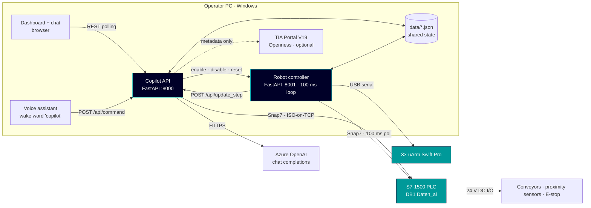
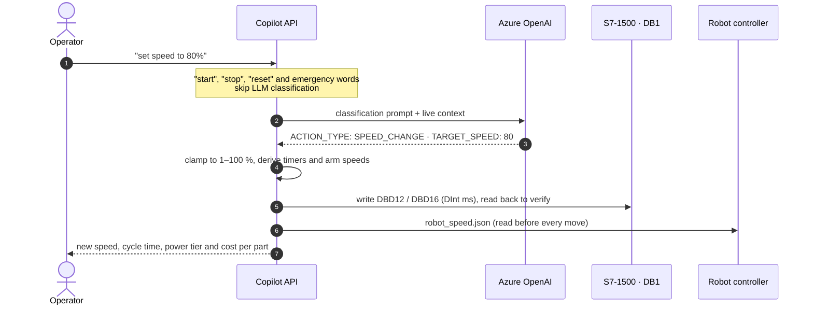
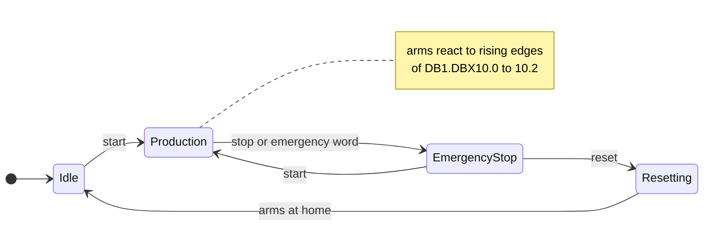

# Architecture

TIA S7 Copilot is split into **two FastAPI services** that share state through small JSON files.
The split is deliberate: LLM calls take seconds and their latency varies, so they must never
hold up the 100 ms loop that reads the PLC and starts robot sequences.

| | Copilot API (`tia_s7_copilot.api`, port 8000) | Robot controller (`tia_s7_copilot.robot_controller`, port 8001) |
|---|---|---|
| Role | Operator-facing: chat, intent classification, analytics, dashboard | Real-time: PLC polling, arm sequences, emergency stop |
| Talks to | Azure OpenAI, PLC (Snap7), TIA Portal (Openness), robot controller | PLC (Snap7), three uArm Swift Pro over USB serial, copilot API |
| Writes | `robot_speed.json`, `cycle_timing.json`, `step_tracking_data.json`, TIA cache | `robot_status.json`, `cycle_timing.json`, `robot_speed.json` (start-up) |
| Without hardware | Starts in limited mode: default values and some local-state updates, not a PLC simulation | Needs the PLC and all three arms |

The browser only talks to the copilot API. Either service can be restarted while the other keeps
running: the JSON files and the HTTP calls pick up again on the next polling cycle.

## From sentence to PLC write

1. **Fast path.** The exact words `start`, `stop` and `reset` and any message containing
   `emergency stop`, `e-stop`, `halt`, `emergency` or `abort` are handled before any LLM call.
  This avoids waiting for LLM classification, but still depends on the API, controller and
  PLC being responsive. It is not a certified safety function.
2. **Classification.** Anything else goes to the LLM with a strict reply format
   (`ACTION_TYPE`, `CONFIDENCE`, `TARGET_SPEED`, `SPEED_DIRECTION`, `SPEED_AMOUNT`, `REASONING`).
  The prompt asks the model to classify questions as `SCENARIO_ANALYSIS`. That branch does not
  apply speed changes, but classification is not independently enforced. Emergency keywords
  inside a question can also trigger the fast path. See [security and safety](../SECURITY.md).
3. **Execution stays in Python.** The backend parses the reply, clamps the value and does the
   writes itself. The model never sends PLC addresses or raw values.
4. **Answer.** The reply is Markdown, sanitised with DOMPurify before the dashboard shows it.

Conversation history is kept per session (one per browser tab, the voice assistant has its
own), limited to the last 10 exchanges.

### Smart context selection

Every request includes a core context (cell layout, PLC and robot facts) and the question-vs-command
rules (`QUESTION_TYPE_CONTEXT`). The other modules are added only when their keywords appear in the question:

| Module | Added when the question mentions … |
|---|---|
| `ENERGY_CONTEXT` | energy, power, consumption, kWh, watt, per part, electricity |
| `COST_CONTEXT` | cost, €, euro, price, expensive, cheap, how much |
| `SPEED_CONTEXT` | speed, faster, slower, cycle time, timing, increase, decrease, boost, reduce |
| `PRODUCTION_CONTEXT` | parts per, throughput, production, output, daily, hourly, shift, capacity |
| `SCENARIO_CONTEXT` | what if, suppose, imagine, scenario, hypothetical, assuming, let's say |
| `STATUS_CONTEXT` | status, current, now, overview, summary, show me, active |

"Run for *N* hours" questions always get the energy, production and cost modules.

The original cell evaluation reported a reduction from about 6,500 tokens to about 1,800 (−72 %).
That figure is not a benchmark of this repository. The prompt text lives in [`tia_s7_copilot/prompts.py`](../tia_s7_copilot/prompts.py).

### One speed value, two control paths

A speed change has to reach both the PLC (conveyor timing) and the robot controller (arm
velocity). The same request handler attempts both, but these are separate operations, not an
atomic transaction. Partial failures or delayed file reads can leave them inconsistent. Check
timer readback and controller state before relying on an update.

The speed-file path also attempts a best-effort write of `speed % * 5` as a Real to `DB1.DBD22`
for external simulation synchronization; failure of that write does not fail the file update.

| Quantity | Formula (s = speed %) | 50 % | 80 % | 100 % |
|---|---|---|---|---|
| Prox 1 → conveyor 1 timer, `DB1.DBD12` | 8000 − 50·s ms, clamped 3000–8000 | 5500 ms | 4000 ms | 3000 ms |
| Prox 3 → conveyor 2 timer, `DB1.DBD16` | 9000 − 40·s ms, clamped 5000–9000 | 7000 ms | 5800 ms | 5000 ms |
| Arm move speed (uArm units) | 100 000 + 7 900 000 · s/100 | 4 050 000 | 6 420 000 | 8 000 000 |
| Expected cycle time | interpolated from (30, 100), (50, 80), (75, 70), (100, 66) s | 80.0 s | 69.2 s | 66.0 s |

## Robot controller

The controller runs one daemon loop and a worker thread for each arm sequence:

- **Polling.** Each loop reads `DB1.DBB10` (arm trigger bits) and `DB1.DBX0.1` (Stop), then
  sleeps for 100 ms. I/O and processing add to that interval; it is not a hard real-time deadline.
  A sequence thread is only started on a rising edge (false → true), so a bit that stays high
  never starts the same sequence twice.
- **Arm 1** alternates between its two sequences on each trigger, so one PLC bit can drive two
  behaviours. `DB1.DBX10.0` and `DB1.DBX10.2` (part reached proximity sensor 4) both trigger it.
- **Arm 2** starts on `DB1.DBX10.1`.
- **Arm 3** needs no PLC bit. It launches as soon as Arm 2 *reaches* waypoint 4 at
  (190, 210, 120) mm, so the two arms overlap their motion.
- **Arm 2, sequence 2** waits on a *pending* flag until Arm 3 reaches (165, −5, 180) mm.
  Waiting on positions reduces dependence on fixed hand-over delays; new speeds and layouts
  still require physical validation.
  A position counts as reached within max(10 mm, 10 % of the coordinate) on each axis.
- **Busy flags** under locks prevent two sequences from sharing an arm. Every motion command
  checks the emergency-stop flag first.
- **Status.** The controller writes `robot_status.json` every second and posts each step
  (`TO CONVEYOR`, `PLACING`, `RELEASING`, …) to `/api/update_step` so the dashboard can show
  live progress bars.

### System states

| Command | What is written | Robot controller |
|---|---|---|
| `start` | `Stop` = 0, `Start` = 1, `POST :8001/api/enable_system` | reacts to PLC triggers again |
| `stop`, `emergency stop`, `e-stop`, `emergency`, `halt`, `abort` | `POST :8001/api/disable_system`, `Stop` = 1, `Start` = 0 | sees the `Stop` edge, flushes every command queue, switches pumps and grippers off |
| `reset` | `Stop` = 1, `Start` = 0, `POST :8001/api/reset_robots` | tools off, emergency flag cleared, all arms home at 30 % speed |

The services start with production triggers **disabled**. This is not a physical motion
interlock: initialization and reset operations can send hardware commands. `start` clears the
PLC stop bit; this implementation does not enforce a reset-only recovery path. The original
cell evaluation reported 81 ms maximum inter-arm activation skew, not a guaranteed stop time.

## Shared state files

All files live in `data/`, or in `COPILOT_DATA_DIR` if that variable is set. Readers use
error-handling paths that may return defaults or cached values. Files are not exchanged
transactionally, and defaults are not confirmation of a safe or current physical state.

| File | Written by | Read by | Content |
|---|---|---|---|
| `robot_speed.json` | copilot API, robot controller (start-up) | both | speed %, move/catch speed, expected cycle time |
| `robot_status.json` | robot controller | copilot API | per-arm moving flag and current step |
| `step_tracking_data.json` | copilot API | copilot API | step history posted by the controller |
| `cycle_timing.json` | robot controller, copilot API | copilot API | measured and expected cycle times |
| `robot_reset_command.json` | copilot API | – | reset request, only written when the controller is unreachable |
| `voice_status.json` | voice assistant | copilot API → dashboard | listening state, last command and reply |
| `tia_cache_*.json`, `plc_tags.json`, `plc_hardware.json` | TIA module | TIA module | Openness export used in JSON-cache mode |

## Energy and production model

- **Power assumptions:** the model assigns each arm 150 W at speeds up to 50 %, 250 W above,
  and 5 W when idle. Conveyors are assigned 50 W running and 2 W idle, at €0.15/kWh.
  Model totals range from 19 W idle to 850 W with all components active at high speed.
- **The estimate improves as cycles complete.** Before any cycle has finished, energy per part
  is estimated from a baseline utilisation model of the assembly sequence. After the first
  cycle, measured component active times replace the estimates where they exist. After five
  valid cycles, the timing breakdown can use recorded cycles. Component power remains assumed,
  not metered. The analytics report which level (baseline, medium, high) they used.
- **Scenario analysis** uses speed simulations, custom on/off scenarios
  (`/api/custom_scenarios`) and all 32 arm/conveyor combinations (`/api/all_scenarios`).
  These scenario-calculation paths do not apply speed changes. Natural-language routing to them
  still depends on classification.

## Dashboard

The dashboard is plain HTML, CSS and JavaScript served by the copilot API. There is no build step.

| Data | Refresh |
|---|---|
| PLC variables, robot state, energy, proximity sensors | 1.5 s |
| Assembly stage, next action, per-arm step progress | 2 s |
| Voice assistant state | 200 ms |

The page compares each response with the previous one and skips DOM writes when nothing changed.
Updates are debounced by 100 ms. Light and dark themes switch by swapping CSS custom properties.
