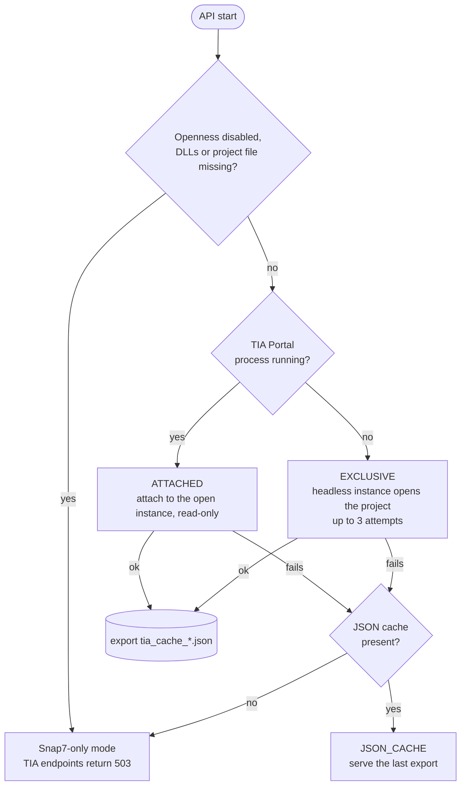

# TIA Portal integration (dual mode)

The copilot can read the **engineering data** of the PLC project (tags, program blocks, hardware
configuration) through the TIA Portal Openness API. With that data the assistant can answer
questions such as "which address is Prox_sensor_3?" or "what blocks does the program have?".

Runtime control never goes through Openness. Every live read and write uses **Snap7**, which took
about 8 ms per operation on the cell against about 45 ms for an equivalent Openness call.
If Openness is unavailable, nothing changes except the `/api/tia/*` endpoints and the extra
context in the chat.

## Modes

When the copilot API starts, it checks whether TIA Portal is running and picks a mode:



| Mode | When | Access | Notes |
|---|---|---|---|
| `ATTACHED` | TIA Portal is open with the project loaded | read-only | You can keep working in TIA Portal. Changes are visible to the copilot |
| `EXCLUSIVE` | TIA Portal is closed | full | Started without a user interface (`WithoutUserInterface`) |
| `JSON_CACHE` | Live connection failed but an earlier export exists | cached | Uses `data/tia_cache_tags.json`, `_blocks.json`, `_hardware.json` |

After a successful live connection, the module attempts to export tags, blocks, hardware and
project info to `data/tia_cache_*.json`. Startup fallback requires the tags, blocks and hardware
files, plus available Openness DLLs and an existing configured project file. Disabling Openness
or removing that project bypasses cache fallback. Cache data is a snapshot, not live telemetry;
do not assume automatic runtime failover when TIA Portal closes.

> [!WARNING]
> Attachment selects the first running TIA instance and its first project. The shutdown path
> calls `project.Close()` even in attached mode. Save engineering work before attaching or
> stopping the API; metadata reads do not make the project's lifecycle read-only.

## Setup (Windows only)

1. Install **TIA Portal V19** with the **Openness** option and add your Windows user to the local
   group *Siemens TIA Openness*. Log off and on again.
2. Install the extra Python dependency:

   ```powershell
   pip install -r requirements-tia.txt   # pythonnet
   ```

3. Configure `.env`:

   ```ini
   TIA_PROJECT_PATH=C:\path\to\your\project.ap19
   TIA_VERSION=V19
   TIA_OPENNESS_PATH=C:\Program Files\Siemens\Automation\Portal V19\PublicAPI\V19
   ```

4. Start the copilot API. The console shows the selected mode. You can also check it at any time:

   ```bash
   curl -s localhost:8000/api/tia/status
   ```

   ```json
   {
     "available": true,
     "connected": true,
     "details": {
       "connection_mode": "ATTACHED",
       "using_json_cache": false,
       "tia_available": true,
       "plc_software_found": true,
       "cached_tags": 36,
       "connection_error": null
     }
   }
   ```

   The `details` object is shortened here. It also contains block counts and cache ages.

Set `TIA_OPENNESS_DISABLED=1` to skip Openness completely, for example on a machine without
TIA Portal. The tests and CI run that way.

## Troubleshooting

| Message | Cause | Fix |
|---|---|---|
| `TIA Openness DLLs not available` | pythonnet missing or wrong `TIA_OPENNESS_PATH` | install `requirements-tia.txt`, check the path |
| `Project file not found` | `TIA_PROJECT_PATH` does not point to an `.ap19` file | fix the path in `.env` |
| `No TIA Portal processes found` | TIA Portal closed while the API was starting | restart the API. It then uses `EXCLUSIVE` mode |
| `No cached JSON files found` | first run without a live connection | connect once (open or close TIA Portal) to create the cache |
| Openness access prompt | first Openness access from Python | confirm the dialog in TIA Portal |
