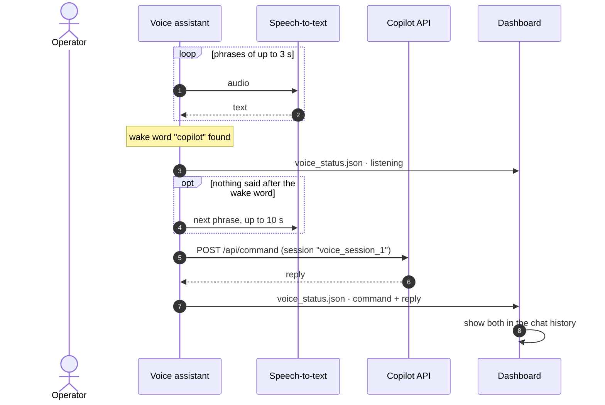

# Voice assistant

You can talk to the cell hands-free. The voice assistant starts together with the copilot API
whenever its dependencies are installed. There is nothing to click.

```text
"copilot, what is my current speed?"
"copilot, set speed to 70 percent"
"copilot, how much energy does one part take?"
"copilot, stop"
```

## How it works



- The microphone is calibrated for ambient noise once at start-up.
- The assistant listens in short phrases (5 s timeout, up to 3 s of speech). When a phrase
  contains **"copilot"**, everything after the wake word is the command. If nothing follows,
  it listens once more for up to 10 s.
- Commands go through the same `/api/command` pipeline as typed text, including keyword
  shortcuts and model-based classification. Transcription and classification can be wrong;
  voice commands are not a safety control.
- The dashboard polls `/api/voice/status` every 200 ms. The microphone button pulses in petrol
  while the assistant waits for the wake word and in red while it records a command. A status
  chip shows *Say "copilot"*, *Listening…* or *Processing…*. Spoken commands and replies
  appear in the normal chat history.

> [!IMPORTANT]
> Speech is transcribed with the free Google Web Speech API (`recognize_google` from the
> SpeechRecognition package), so **audio is sent to an external service** and the PC needs
> internet access. Do not use the voice assistant where that is not acceptable.

## Installation (Windows)

```powershell
scripts\install_voice.bat
# or, inside the virtual environment
pip install -r requirements-voice.txt   # SpeechRecognition + PyAudio
```

PyAudio publishes Windows wheels for Python 3.8–3.13. On newer versions, build it against
PortAudio or create the virtual environment with Python 3.13.

If the dependencies are missing, the API logs that the voice assistant is unavailable and
everything else keeps working. The microphone button then stays inactive.

## Troubleshooting

| Symptom | Fix |
|---|---|
| Wake word never detected | Check *Windows Settings → Privacy → Microphone* and the default input device. Speak "copilot" clearly at the start of the sentence |
| `Speech recognition error` in the console | No internet access to the speech service |
| Microphone in use | Close other applications that hold the microphone |
| PyAudio fails to install | Use Python ≤ 3.13 for the virtual environment (see above) |
